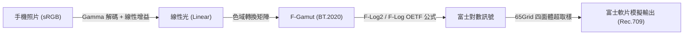

# FujiLUT-for-Mobile: Fujifilm 3D LUT Converter for Smartphone Photography

將富士官方技術級 **F-Log2 / F-Log 3D LUT**（`.cube`）精確重取樣並烘焙（Bake）為適用於手機直出照片（sRGB / Rec.709，如 Snapseed、Lightroom Mobile、VN 等）的輕量化軟片模擬濾鏡。

提供 **「100% 純前端靜態網頁版（手機免安裝即用）」** 與 **「Python 高速批次轉換腳本」** 兩種使用方式，底層共用完全一致的白皮書色彩科學與四面體插值數學核心。

## 📸 解決的核心痛點

### 為什麼富士官方 LUT 直接套在手機照片上會「壞掉」？

富士官網釋出的免費 3D LUT 檔（如 `FLog2_to_CLASSIC-Neg.`）是專為專業相機錄製的 **F-Log2 灰片** 設計的：

* **官方設計**：輸入端為 **F-Log2（極低反差灰片）** → 輸出端為 **Rec.709（正常標準對比）**。LUT 內部包含大幅度的高光下壓、暗部拉扯與高飽和度映射。

* **手機現狀**：智慧型手機拍攝（包含 JPG/HEIC 或經由 Snapseed 沖印的 DNG RAW）輸出時，影像已經過演算法色調映射（Tone Mapping）處於標準 **sRGB** 狀態。

* **直接套用的結果**：對比度與飽和度被重複放大兩次，造成**高光嚴重死白、暗部死黑、膚色蠟黃失真**。

### 本工具的解決方式

本專案在數學層面進行**逆向色彩管線烘焙**，將輸入端重新對齊為標準手機照片色彩空間：



藉由將 **65Grid 高精度母片** 超取樣（Supersampling）至手機端最流暢相容的 **33Grid**，消除非線性插值色階斷層，同時針對手機介面字數限制最佳化檔名，在選單中一目了然。

## ✨ 特色亮點

* **100% 純前端零隱私外洩網頁工具**：

  * 零後端、零建置工具（原生 HTML5 + CSS3 + ES Modules + Web Worker），所有 `.cube` 剖析、四面體重取樣與照片預覽皆在瀏覽器本地端執行，並透過嚴格 CSP（`connect-src 'none'`）強制封鎖任何外部連線。

  * 支援 **來源對數曲線切換**（`F-Log2` / 一代 `F-Log` 自動偵測）、**輸出網格尺寸選擇**（`17Grid` / `33Grid` / `65Grid`）、**線性曝光增益（Linear Gain `0.8x ~ 2.5x`）** 高光滾降微調、**濾鏡混合強度（Intensity `10% ~ 100%`）** 與 **本機測試照片即時分割對比**。

  * 內建 **Snapseed 9 半形字元寬度即時截斷預覽器**，並以 `application/octet-stream` 觸發下載，確保 Android Chrome 與 iOS Safari 完整保留 `.cube` 字尾而不被附加 `.txt`。

* **針對 Snapseed 介面寬度最佳化檔名**：考量 Snapseed 預覽列僅能顯示約 9 個英文字元寬度（超過即縮略為 `…`），檔名捨棄冗餘編號，直接將 **4 字中文適用情境** 置於最前方（如 `人文街拍_Classic-Neg.cube`），未點擊時即可完整辨識情境，點擊後可檢視完整官方軟片名稱。

* **100% 官方白皮書對齊**：

  * 嚴格遵循富士官方《F-Log2 Data Sheet Ver.1.1》第 2-3 節的分段式雙向對數轉換公式（正向 `cut1 = 0.000889`、逆向 `cut2 = 0.100686685370811`）與一代《F-Log Data Sheet》規範，並自動針對 `FLog2-709`（`#Gamma:F-Log2 to F-Log2`）補齊逆轉換與 sRGB 編碼。

  * 依據白皮書第 3 節 CIE 1931 色度座標精確推導 ITU-R BT.709 轉 F-Gamut（ITU-R BT.2020）色域矩陣，確保 `float64` 下 D65 白點嚴格守恆，杜絕紅、綠色偏。

* **`O(1)` 常數時間四面體插值（Tetrahedral Interpolation）**：

  * 利用均勻等距網格特性直接算術定址，淘汰 `O(log N)` 二分搜尋。

  * 沿立方體主對角線切分四面體，確保灰階中性軸 `100%` 落於主對角線端點（消除三線性插值跨色角平均造成的微綠偏色），並將每點頂點查找與乘加次數由 8 次降至 4 次。

* **降維與背景多執行緒最佳化**：

  * 1D 軸預計算將 sRGB 指數解碼運算從 107,811 次降至 33 次。

  * 網頁版採用 Web Worker + Transferable `ArrayBuffer` 零複製傳輸，處理 274,625 點母片或拖曳滑桿預覽本機照片時主執行緒零卡頓。

## 🚀 快速上手

### 第一步：下載富士官方 LUT 母片

至富士官方網站下載 3D LUT 壓縮包（建議下載包含最完整軟片模擬的 **GFX ETERNA 55** 或 **X-H2S / X-T5** 韌體支援包），解壓縮後取得 `65Grid/F-Log2`（或 `33Grid` / `F-Log`）資料夾內的 `.cube` 檔案。

---

### 🌐 方式一：使用純前端靜態網頁版（手機／電腦免安裝推薦）

1. 開啟部署於 GitHub Pages 的線上工具網址（或於本機啟動靜態伺服器）。
2. 點擊上傳區或拖曳單一富士原始 `.cube` 母片（如 `FLog2_to_CLASSIC-Neg._65grid_V.1.00.cube`），系統將自動偵測網格尺寸、預選 `F-Log2` / `F-Log` 曲線並帶入推薦情境短名。
3. 依需求調整 **輸出網格尺寸**（預設 `33Grid`）、**線性曝光增益（Linear Gain）**、**濾鏡混合強度** 與 **命名模式**（可即時檢視 Snapseed 9 半形字元截斷預覽）。
4. （選填）展開下方 **「本地測試照片即時預覽」**，載入本機手機照片並使用原生滑桿或鍵盤方向鍵比對原圖與套用後效果。
5. 點擊 **「轉換並下載 .cube 濾鏡」**，即可直接儲存至手機檔案系統匯入修圖軟體。

#### 在 GitHub Pages 一鍵啟用部署

本專案採用零建置工具架構（根目錄含 `index.html`、`css/`、`js/` 與 `.nojekyll`），Fork 或推送至 GitHub 後即可直接上線：

1. 進入 GitHub 儲存庫的 **Settings** → 左側選單點選 **Pages**。
2. 在 **Build and deployment** 區塊，將 **Source** 設為 **Deploy from a branch**。
3. 在 **Branch** 下拉選單選擇 **`main`** 分支與 **`/ (root)`** 資料夾，點擊 **Save**。
4. 等待約 30 秒部署完成，即可透過 `https://<你的帳號>.github.io/fuji-lut-for-mobile/` 用手機瀏覽器直接開啟使用。

#### 本機啟動預覽與驗證測試

因瀏覽器對 ES Modules 與 Web Worker 的安全限制，本機開發請經由靜態 HTTP 伺服器開啟（請勿直接以 `file://` 點開）：

```bash
# 使用 uv 啟動本機靜態網頁伺服器
uv run python -m http.server 8000
# 開啟瀏覽器造訪 http://localhost:8000

# 執行 Node.js + Python 雙端 35,937 點數值一致性與資安自動化驗證
node tests/verify-converter.mjs
```

---

### 🐍 方式二：使用 Python 批次轉換工具（一次轉換整個資料夾）

推薦使用現代極速 Python 工具 [**uv**](https://github.com/astral-sh/uv)，免手動建置虛擬環境：

```bash
# Clone 此專案
git clone https://github.com/abc0922001/fuji-lut-for-mobile.git
cd fuji-lut-for-mobile

# 將官方 65Grid/F-Log2 資料夾放置於專案根目錄下

# 使用 uv 一鍵執行批次轉換
uv run --with numpy convert_flog2.py
```

*如果你使用標準 Python 環境：*

```bash
pip install numpy
python convert_flog2.py
```

轉換完成後，產出的 `.cube` 檔案將存放於 `Fuji_LUT_Best_33Grid/`。

## 📱 情境導向命名與對照表

檔案名稱採用 `四字情境_官方模擬名稱.cube` 結構，確保在 Snapseed 僅 9 個英文字元寬度的縮略預覽列中，最關鍵的**前 4 個中文字情境**能完整顯示不被截斷：

| 輸出情境檔名 | Snapseed 縮略預覽 | 原官方檔名 | 建議適用情境與色調特色 | 
| ----- | ----- | ----- | ----- | 
| `人文街拍_Classic-Neg.cube` | `人文街拍_…` | `FLog2_to_CLASSIC-Neg._65grid_V.1.00.cube` | **街拍首選**，高反差、冷暖對比強烈、獨特綠色調與復古底片感 | 
| `真實紀實_Classic-Chrome.cube` | `真實紀實_…` | `FLog2_to_CLASSIC-CHROME_65grid_V.1.00.cube` | 紀實攝影必備，低飽和、微冷調雜誌文青感 | 
| `自然通透_Reala-Ace.cube` | `自然通透_…` | `FLog2_to_REALA-ACE_65grid_V.1.00.cube` | 富士最新旗艦色彩，色彩忠實自然、階調立體通透 | 
| `柔和人像_Astia.cube` | `柔和人像_…` | `FLog2_to_ASTIA_65grid_V.1.00.cube` | 柔和高光與紅潤膚色表現，家庭生活與人物拍攝首選 | 
| `標準正片_Provia.cube` | `標準正片_…` | `FLog2_to_PROVIA_65grid_V.1.00.cube` | 富士經典標準色，發色均衡，各類生活記錄皆適宜 | 
| `濃郁風景_Velvia.cube` | `濃郁風景_…` | `FLog2_to_Velvia_65grid_V.1.00.cube` | 極高色彩飽和度，適合晴天、藍天、草地與夕陽大景 | 
| `棚拍人像_Pro-Neg-Std.cube` | `棚拍人像_…` | `FLog2_to_PRO-Neg.Std_65grid_V.1.00.cube` | 極柔和的陰影階調與低對比，適合控光人像與微距特寫 | 
| `低調電影_Eterna.cube` | `低調電影_…` | `FLog2_to_ETERNA_65grid_V.1.00.cube` | 經典電影正片色調，低反差、低動態衝擊、平滑高光過渡 | 
| `重工業風_Eterna-BB.cube` | `重工業風_…` | `FLog2_to_ETERNA-BB_65grid_V.1.00.cube` | 漂白效果（Bleach Bypass），極低飽和伴隨強烈對比的金屬冷硬質感 | 
| `經典黑白_Acros.cube` | `經典黑白_…` | `FLog2_to_ACROS_65grid_V.1.00.cube` | 頂級黑白底片模擬，暗部細節豐富且高光立體分明 | 
| `標準還原_Rec709-Std.cube` | `標準還原_…` | `FLog2_to_FLog2-709_65grid_V.1.00.cube` | 基準技術轉換檔，不帶軟片風格濾鏡之標準 Rec.709 色彩 | 
| `寬動態域_Rec709-WDR.cube` | `寬動態域_…` | `FLog2_to_WDR-709_65grid_V.1.00.cube` | 具備高光滾降保護的寬動態標準色彩還原 | 

## 📲 如何在 Snapseed 中套用

1. 透過線上網頁工具直接下載 `.cube` 濾鏡至手機，或將 `Fuji_LUT_Best_33Grid/` 內的 `.cube` 檔案經由 AirDrop、Google Drive 或傳輸線傳至手機儲存空間。

2. 打開 **Snapseed** 並載入照片（JPG / HEIC 或 DNG RAW 皆可）。

3. 點選下方 **「工具」** → **「LUT」**。

4. 點選「開啟檔案」選取目標情境檔案（例如在街拍場景點選 `人文街拍_Classic-Neg.cube`）。

5. 根據現場光線與對比偏好，左右滑動調整套用強度（建議強度：`70% ~ 100%`）。

## 📄 License

本專案程式碼基於 [MIT License](LICENSE) 開放原始碼。

*免責聲明：富士軟片模擬之色彩科學與商標權屬 FUJIFILM Corporation 所有，本專案僅提供色彩空間轉換演算法實作，官方原始 `.cube` 檔請逕自富士官網下載。*
